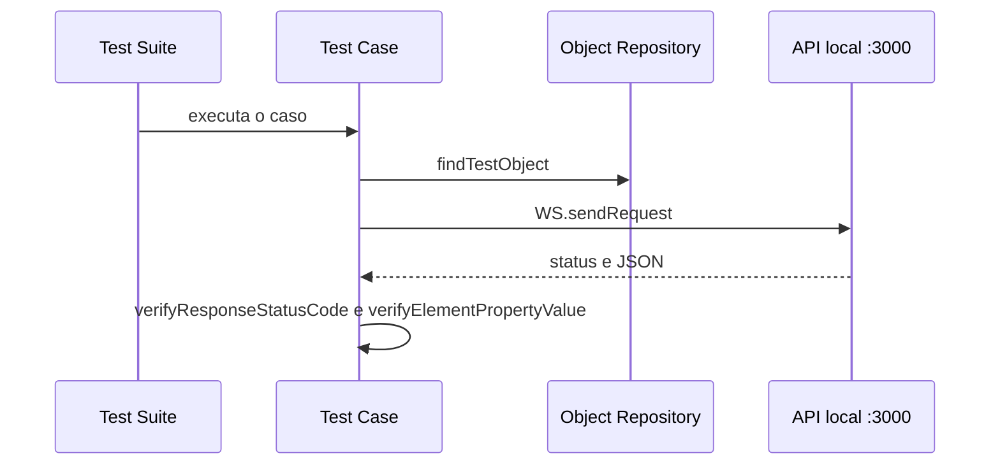

# Estudar automação de API no Katalon

Este repositório é uma trilha curta para ver, na prática, como o Katalon Studio testa uma API REST.

A API é local e pequena: um cadastro de tarefas em memória. Os testes do Katalon chamam essa API, leem a resposta e marcam o caso como passou ou falhou. O arquivo que você está lendo é o caderno dessa trilha. Quando avançar um passo, anote no [Diário](#diário).

## A ideia em uma frase

O **pedido HTTP** fica guardado para reutilizar. O **teste** envia esse pedido e confere a resposta. A **suíte** junta os testes e gera o relatório.



| Peça no Katalon | Onde fica | Para que serve |
| --- | --- | --- |
| Variável global `baseUrl` | `Profiles/default.glbl` | Endereço da API, usado por todos os pedidos |
| Web Service Request | `Object Repository/Tarefas/` | Método, URL, cabeçalho e corpo. Ainda não é um teste |
| Test Case | `Test Cases/` + `Scripts/` | Envia o pedido e faz as conferências. Aqui nasce o passou/falhou |
| Test Suite | `Test Suites/Tarefas - estudos.ts` | Roda os casos em sequência e produz o relatório |

O pedido sozinho serve para experimentar no editor (botão **Test Request**). O resultado que entra em relatório é o do test case.

## O que você precisa

- Python 3, para a API local. Não há `pip install`: o servidor usa só a biblioteca padrão.
- [Katalon Studio](https://katalon.com/download), edição gratuita, para executar os testes. Os scripts Groovy dependem das bibliotecas do Studio e não rodam com `python` nem com `groovy` solto no terminal.

Se o Windows pedir permissão de rede para o Python na primeira subida, é o servidor local.

## 1. Subir a API

Na pasta do repositório:

```powershell
python demo-api/server.py
```

A API fica em `http://127.0.0.1:3000`. Deixe esse terminal aberto. Em outro terminal:

```powershell
curl.exe http://127.0.0.1:3000/health
curl.exe http://127.0.0.1:3000/tarefas
```

No PowerShell, `curl` às vezes é apelido de `Invoke-WebRequest`. `curl.exe` é o cliente HTTP.

Contrato que os testes conhecem:

| Método | Caminho | Sucesso | Corpo |
| --- | --- | --- | --- |
| GET | `/health` | 200 | `{"status":"ok","servico":"tarefas"}` |
| GET | `/tarefas` | 200 | lista de tarefas |
| GET | `/tarefas/{id}` | 200 ou 404 | a tarefa, ou `{"erro":"Tarefa nao encontrada"}` |
| POST | `/tarefas` | 201 | a tarefa criada, com `id` novo |
| PUT | `/tarefas/{id}` | 200 ou 404 | a tarefa atualizada |
| DELETE | `/tarefas/{id}` | 204 | sem corpo |

POST e PUT pedem JSON:

```json
{ "titulo": "Estudar Katalon", "feita": false }
```

`titulo` vazio responde **400** com `{"erro":"Informe o titulo"}`.

Ao abrir, a API já tem duas tarefas: "Ler o README" (`feita: false`) e "Subir a API local" (`feita: true`). Os dados vivem só na memória. `Ctrl+C` no servidor apaga o que os testes criaram e, na próxima subida, as duas tarefas de exemplo voltam. Se um teste de lista falhar porque a primeira tarefa mudou, reinicie o servidor.

Para usar outra porta: `$env:PORT = "3001"; python demo-api/server.py` e, no Katalon, ajuste `baseUrl` no perfil `default`.

## 2. Abrir o projeto no Katalon Studio

1. **File > Open Project**.
2. Escolha `katalon-api.prj`, nesta pasta.
3. Se o Studio oferecer migração do projeto, aceite. O formato foi montado no modelo do projeto oficial de Web Service do Katalon.

No **Tests Explorer** você deve ver:

- **Profiles > default**, com `baseUrl = 'http://127.0.0.1:3000'`. O valor é uma expressão Groovy: texto fica entre aspas simples.
- **Object Repository > Tarefas**, com um pedido para cada rota.
- **Test Cases**, do 01 ao 06.
- **Test Suites > Tarefas - estudos**.

A pasta `demo-api` não aparece no explorer. O Studio só lista as pastas dele.

## 3. Rodar

Com a API no ar, clique com o botão direito em **Test Suites > Tarefas - estudos** e escolha **Run**.

O log de cada caso mostra as frases entre aspas que estão no script (`'Envia GET /health'`, e as seguintes). Essas strings são passos do Groovy: elas não chamam a API, só aparecem no relatório para marcar o que o caso está fazendo.

Para um caso só, o mesmo clique direito em cima do test case.

Para inspecionar um pedido sem rodar a suíte, abra o request em **Object Repository > Tarefas** e use **Test Request and Verify**. As conferências deste projeto estão nos test cases, não na aba Verification do pedido. Por isso o **Test Request** mostra a resposta, e quem marca passou ou falhou é o test case.

O relatório da execução feita fora do Studio está em [`relatorio/ultima-execucao.html`](relatorio/ultima-execucao.html). Abra no navegador. Para gerar de novo, com a API no ar:

```powershell
python relatorio/gerar_relatorio.py
```

Quando a suíte roda dentro do Katalon Studio, o relatório oficial vai para a pasta `Reports/`. Ela está no `.gitignore` porque o Studio cria uma pasta nova a cada execução.

## 4. O teste mais curto, por dentro

O pedido `GET health` só declara método e URL. A URL usa a variável global, então o mesmo pedido serve em outra porta sem editar o request:

```text
GET ${GlobalVariable.baseUrl}/health
```

O test case `01 Verificar saude da API` faz o trabalho de teste:

```groovy
def response = WS.sendRequest(findTestObject('Object Repository/Tarefas/GET health'))
WS.verifyResponseStatusCode(response, 200)
WS.verifyElementPropertyValue(response, 'status', 'ok')
WS.verifyElementPropertyValue(response, 'servico', 'tarefas')
```

- `findTestObject` lê o arquivo `.rs` do Object Repository.
- `WS.sendRequest` dispara o HTTP e devolve a resposta.
- `verifyResponseStatusCode` compara o status. Se vier 500, o caso falha aqui.
- `verifyElementPropertyValue` lê um campo do JSON. O segundo argumento é o caminho do campo (`status`, `titulo`, `[0].titulo` quando a raiz é uma lista).

Status 200 com corpo errado também é falha. Por isso o caso confere os dois.

## 5. Os seis casos

| Caso | O que exercita | O que você aprende |
| --- | --- | --- |
| 01 Verificar saude da API | GET `/health` | O menor teste possível: status e dois campos |
| 02 Listar tarefas | GET `/tarefas` | Caminho `[0].titulo` dentro de uma lista JSON |
| 03 Buscar tarefa inexistente | GET `/tarefas/99999` | 404 é o resultado esperado, não um erro do teste |
| 04 Recusar tarefa sem titulo | POST com `titulo` vazio | O mesmo pedido do caso 05, com outros valores, e status 400 |
| 05 Criar tarefa | POST | 201, campos de volta, e o `id` lido com `JsonSlurper` |
| 06 Fluxo completo de uma tarefa | POST, GET, PUT, DELETE, GET | Um caso encadeia chamadas e usa o `id` que a API devolveu |

O caso 04 e o caso 05 usam o **mesmo** request `POST tarefa`. A diferença está no mapa passado para `findTestObject`:

```groovy
findTestObject('Object Repository/Tarefas/POST tarefa', [
    'titulo': 'Criada pelo teste 05',
    'feita': false
])
```

Esse mapa substitui, só nessa chamada, as variáveis do pedido. No `.rs`, o corpo está escrito com `${titulo}` e `${feita}`. O valor padrão (`'Estudar Katalon'`) vale quando ninguém passa outro.

No caso 06 o `id` não é fixo. O POST devolve o número, o `JsonSlurper` lê o JSON, e os pedidos seguintes colocam esse número na URL. É o padrão de um fluxo de verdade: criar, consultar o que foi criado, alterar, apagar, provar que acabou.

`DELETE` com sucesso responde **204** e não manda corpo. O caso só confere o status. Conferir um campo nesse ponto falharia, porque não há JSON.

## 6. Três lugares onde um valor pode morar

Não misture os três. Cada um tem um alcance diferente.

- **Variável global** (`GlobalVariable.baseUrl`): o projeto inteiro. Perfil `default`.
- **Variável do request** (`${titulo}`, `${id}`): aquele pedido. O teste pode trocar o valor na hora do `findTestObject`.
- **Valor dentro do script** (`'Criada pelo teste 05'`): só aquele test case.

O padrão de uma variável no Object Repository é uma expressão Groovy. Número vai sem aspas (`1`, `false`). Texto vai com aspas simples (`'Estudar Katalon'`). Sem as aspas, o Studio tenta ler o texto como nome de variável e o pedido quebra.

## Mapa dos arquivos

```text
katalon-api.prj                          projeto que o Studio abre
Profiles/default.glbl                    baseUrl
Object Repository/Tarefas/*.rs           os seis pedidos HTTP
Test Cases/*.tc                          metadados de cada caso
Scripts/<mesmo nome do caso>/*.groovy    o código que roda
Test Suites/Tarefas - estudos.ts         a suíte
demo-api/server.py                       a API que os testes chamam
relatorio/ultima-execucao.html           relatório da última execução fora do Studio
```

O Studio associa o caso ao script pela pasta: `Test Cases/01 Verificar saude da API.tc` usa o Groovy em `Scripts/01 Verificar saude da API/`.

## Quando algo falhar

- **Connection refused** no log: a API não está no ar, ou a porta do `baseUrl` não é a do servidor.
- Título com aspas ou quebra de linha no meio do texto pode gerar um JSON inválido. O corpo do pedido é montado por substituição de texto (`"titulo": "${titulo}"`). Os títulos desta trilha não usam aspas.
- O caso 02 falha em `[0].titulo`: a primeira tarefa da memória mudou. Reinicie `demo-api/server.py`.
- O Studio abre o caso com o script vazio: confira se existe um único `.groovy` na pasta `Scripts/<nome do caso>/`. O nome do arquivo começa com `Script`.

## Próximas lições

Cada uma cabe num acréscimo pequeno. Quando fizer, registre no diário o que mudou e o que o relatório mostrou.

1. **Ver uma falha de propósito.** No caso 01, troque o valor esperado de `ok` para `fora`. Rode só esse caso, leia a mensagem no log e volte o valor. Automação que nunca falha não ensina onde olhar.
2. **Um pedido novo.** Inclua `GET /tarefas/1` como caso próprio, separado do fluxo, esperando o título "Ler o README".
3. **Verification no request.** Na aba Verification de `GET health`, repita a conferência de `status`. Compare **Test Request and Verify** (experimentar) com rodar o test case (relatório).
4. **Keyword sua.** Extraia o POST do caso 05 para `Keywords`, com `@Keyword`, e chame por `CustomKeywords.'...'`. O caso fica curto; o pedido continua no Object Repository.
5. **Data-driven.** Uma planilha com vários títulos, ligada ao caso 05 na suíte, cria uma tarefa por linha sem copiar o script.

Documentação oficial, quando quiser o mesmo fluxo pela interface: [Create your first API test](https://docs.katalon.com/katalon-studio/create-test-cases/create-your-first-api-test-with-katalon-studio) e o [projeto de exemplo de Web Service](https://github.com/katalon-studio-samples/web-service-tests).

## Diário

Anote data, o que você rodou e o que o resultado te mostrou. A primeira entrada é a montagem deste repositório.

### 2026-11-22 — ponto de partida

- API local em `demo-api/server.py`, sem dependências, dados em memória.
- Seis pedidos em `Object Repository/Tarefas`, um por rota.
- Seis test cases. As conferências ficam no script, com `WS.verifyResponseStatusCode` e `WS.verifyElementPropertyValue`. O caso 05 e o 06 também leem o JSON com `JsonSlurper` para usar o `id` devolvido pela API.
- `baseUrl` aponta para `http://127.0.0.1:3000`.
- Ainda não há autenticação, planilha de dados nem keyword customizada. Isso fica para as próximas lições.

### 2026-11-23 — primeira execução

- Seis conferências contra `http://127.0.0.1:3000`. Todas passaram.
- O Katalon Studio não está instalado, então a pasta `Reports/` continuou vazia.
- O resultado ficou em `relatorio/ultima-execucao.html`.
